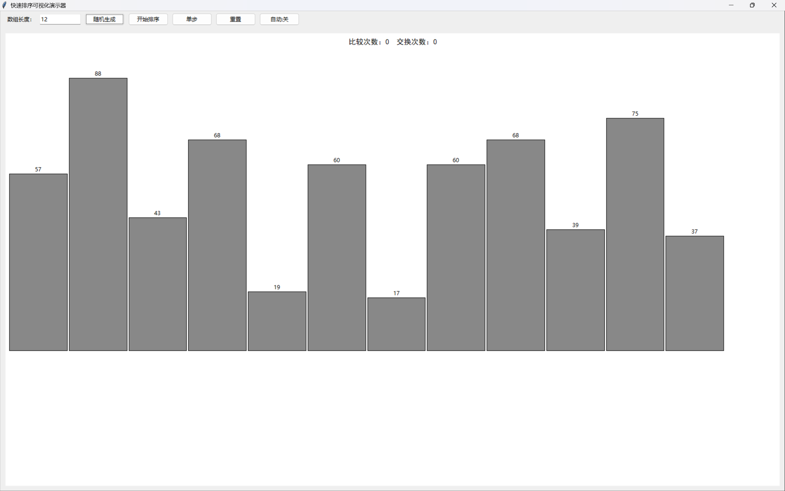
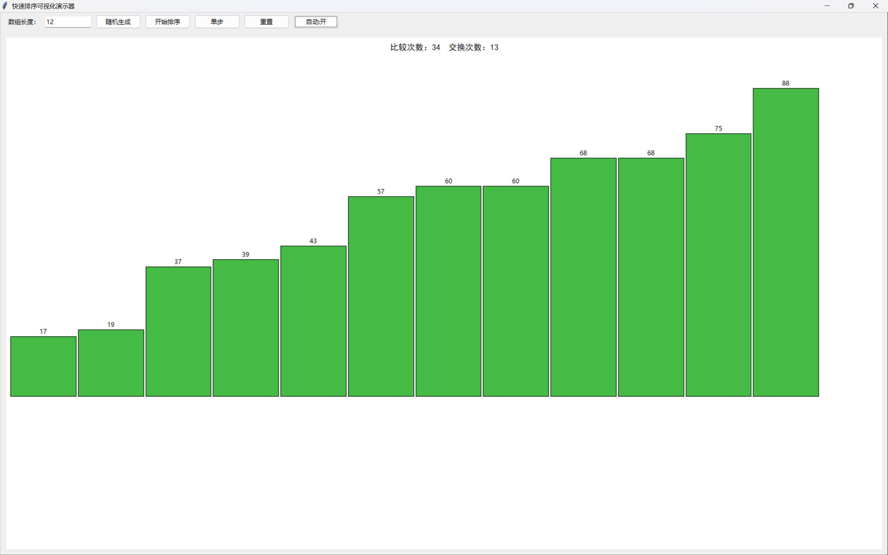

# algorithm
算法演示
## 一、项目简介
本项目是 “无敌暴龙战士” 小组为《计算机与专业基础研讨》大作业开发的桌面演示程序。本项目通过 Python 的 Tkinter 图形库，完整模拟快速排序算法的底层运行机制。通过可视化数组面板、分区过程展示与实时运行日志，帮助学习者直观理解分治思想、基准值选择、分区交换等快速排序核心原理。
## 二、安装与运行指南
### 1.环境依赖
- **操作系统：** Windows 10/11，macOS，或 Linux
- **Python 版本：** Python 3.8 及以上版本（自带 tkinter，无需额外使用 pip 安装）
### 2.运行步骤
打开终端 (Terminal) 或命令提示符，执行以下命令: 

```
# 1. 克隆项目到本地
git clone https://gitee.com/你的仓库地址/quick-sort-demo.git

# 2. 进入项目目录
cd quick-sort-demo

# 3. 运行主程序
python quick_sort.py
```
## 三、Github 仓库链接与 Git 协作记录
**仓库地址：** https://github.com/Zhangx2620/algorithm.git  
**访问权限：** 公开（Public）  
**分支记录 (Branch History):**  
 - main **:** 主分支，存放最终发布的稳定版本。
 - dev **:** 开发分支，测试代码。  
 - Zhangx2620-patch-1 **:** 文档编写分支。
 - feat/ui-render **:** Tkinter界面布局与响应式开发分支。
 - feature/algorithm-core **:** 快速排序底层算法开发分支。  
### 核心提交记录（Commit History）与冲突解决（PR）：
- 99a8b49 [张奥翔] init **：** Initial commit，初始化仓库  
- 3bb4dee [张奥翔] feat(project-setup) **：** 初始化，添加gitignore  
- 377d750 [肖廣桂] feat **:** Create ui_layout.py，创建UI界面布局文件  
- 36bb112 [肖廣桂] update **:** Update ui_layout.py，更新UI布局代码  
- 429f220 [高新杰] feat(algorithm) **:** 快排算法核心模块（两种分区 / 三种基准 / 四种分布）  
- 68871f8 [肖廣桂] feat **:** Add QuickSort visualization application，增加快排可视化应用  
- 712e4e6 [王义豪] 提交需求与设计文档
- c9209b1 [王一伊] 提交测试报告
- 4ca3a13 [张奥翔] docs **:** Enhance README with project details and instructions，完善README项目说明文档    
## 四、软件运行截图  
  
  
## 五、主要功能说明  
- **数组长度：** 设定待排序序列的数据元素个数。
- **随机生成：** 随机生成几个数据元素。
- **开始排序：** 点击后可以开始单步或自动运行。
- **单步：** 系统可以一步一步运行。
- **重置：** 将比较次数和减缓次数清零。
- **自动：** 系统按照一定的延迟时间自动运行。  
## 六、贡献者名单     
本程序由“无敌暴龙战士”小组共同开发
- **张奥翔** （项目经理）：统筹进度与规范、代码合并与README编写
- **肖廣桂** （UI交互设计师）：系统UI布局、界面样式编写
- **高新杰** （算法工程师）：核心算法、排列规则编写
- **王一伊** （QA）：组合测试、BUG追踪、测试报告、实机演示
- **王义豪** （技术文档）编写需求与设计文档、PPT讲解  
## 七、开源协议  
本项目采用 开源协议。