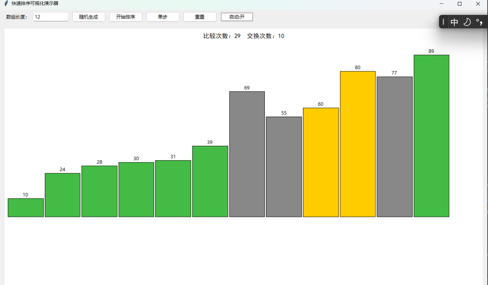
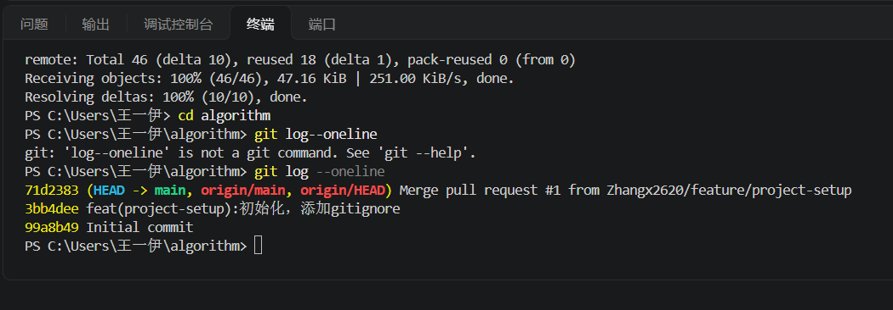

# 快速排序可视化程序测试报告
## 1 测试概述
### 1.1 测试目的
验证快速排序可视化程序的排序逻辑正确性、界面交互功能稳定性，检验自动播放、暂停、重置、速度调节、随机生成数组等功能，确认程序可以正常演示快速排序的分区、交换过程。
### 1.2 测试环境
- 操作系统：Windows
- 运行环境：Python + Tkinter
- 测试版本：feature/project-setup 分支版本
### 1.3 测试范围
排序算法逻辑、自动播放开关、暂停按钮、重置按钮、速度滑块、随机生成数组功能。

## 2 测试用例与结果
| 用例编号 | 测试内容 | 预期结果 | 实际结果 | 是否通过 |
| ---- | ---- | ---- | ---- | ---- |
| TC01 | 点击【随机生成】数组 | 生成一组随机整数，画布刷新展示柱状图 | 正常生成随机数组，图形渲染正常 | 通过 |
| TC02 | 打开自动播放开关，点击【开始】 | 程序开始一步步演示快速排序，柱子变色标记基准、交换元素 | 开启自动播放后，排序动画正常启动，元素交换、分区标记正常 | 通过 |
| TC03 | 排序过程中点击【暂停】 | 动画立刻停止，停留在当前排序步骤 | 点击暂停后动画停止，界面状态正常 | 通过 |
| TC04 | 暂停后再次点击【开始】 | 从暂停的步骤继续往后执行排序动画 | 可接续执行，无跳步、无错乱 | 通过 |
| TC05 | 拖动速度调节滑块 | 动画速度跟随滑块变化，变快/变慢 | 调速生效，延迟时间正常改变 | 通过 |
| TC06 | 排序中途点击【重置】 | 停止动画，回到初始未排序数组状态 | 动画停止，数组重置，界面清空排序标记 | 通过 |
| TC07 | 排序完成后再次点击开始 | 不会重复运行，保持有序状态 | 排序结束后稳定停止，不会重复执行排序 | 通过 |

## 3 发现的问题
本次测试中，程序各项功能均符合设计预期，**无功能性bug**。
使用提示：程序需要先开启自动播放开关，再点击开始按钮，排序动画才会启动；未开启自动播放时，点击开始不会运行动画，属于程序本身的交互逻辑，不是故障。

## 4 测试结论
快速排序核心算法逻辑正确，元素交换、分区展示符合快速排序原理；所有交互功能稳定可用。
程序交互逻辑清晰，只要按照“先开启自动播放，再启动排序”的操作顺序，就可以正常完成排序演示，整体满足本次可视化演示的需求。

## 5 附录
1. 程序运行截图

2. Git仓库提交记录截图
